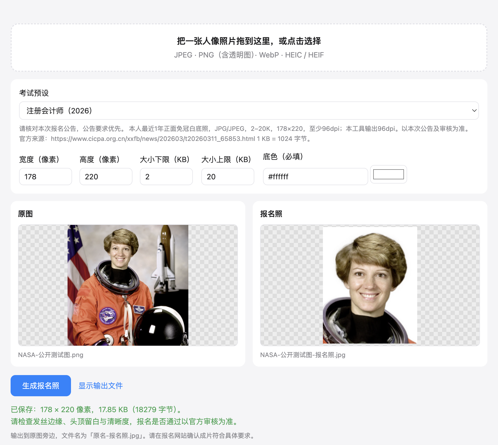

<div align="center">


# 报名照助手

**拖入人像，选报名要求，得到尺寸和大小都达标的报名照。**

人脸居中、头顶留白、本地换底色。照片全程留在你的电脑。

[](https://github.com/Youkou970701/id-photo-tool/releases)




</div>

## 为什么做这个

报名时最容易卡在「照片尺寸不符」「文件超过上限」「底色不对」。
在线处理网站需要上传人像；这个工具把裁剪、换底色、控制文件大小放进同一个窗口，**不收集、不上传任何照片，断网也能使用**。

## 下载

到 [Releases 页面](https://github.com/Youkou970701/id-photo-tool/releases/latest) 下载：

| 系统 | 文件 |
| --- | --- |
| macOS（Apple 芯片 M1 及以后） | `IdPhotoTool-*-mac-arm64.dmg` |
| Windows 64 位 | `IdPhotoTool-*-win-x64.exe`（安装版）或 `.zip`（免安装） |

模型、ONNX Runtime、HEIC 解码器均随安装包内置，首次运行也不下载模型。

<details>
<summary>第一次打开提示「无法验证开发者」？</summary>

应用未购买开发者签名。macOS 请在确认来源后右键应用 → 打开；Windows 的 SmartScreen 可在确认来源后选择「更多信息」→「仍要运行」。

</details>

## 怎么用

1. 拖入一张清晰的正面人像，或点击选择。支持 JPEG、PNG（含透明图）、WebP、HEIC / HEIF、TIFF。
2. 选择考试预设，或按本次公告填写**宽 × 高像素、KB 下限～上限、底色**。
3. 点击「生成报名照」。模型检查是否只有一张人脸，用与人脸连通的 alpha 定位头顶、裁剪换底并匹配文件大小。
4. 成片保存在原图旁边，名为 `原名-报名照.jpg`。同名文件已存在时追加 `-2`、`-3`；**不覆盖原图和已有成片**。
5. 放大检查头发边缘、头顶留白、清晰度，再上传到官方报名系统审核。

无法检测到人脸、发现多人脸、无法达到文件大小区间或保存失败，都会明确报错。尺寸或体积未达标时不保存成片。

## 预设从哪里来

所有预设放在 [presets.json](presets.json)，每条包含 `source` 官方公告链接及说明。核对日期：2026-10-16。

| 考试 | 已核实要求 | 官方来源 |
| --- | --- | --- |
| 注册会计师 2026 | 白底、178 × 220、2～20K、JPG/JPEG、至少 96dpi | [中注协报名答记者问](https://www.cicpa.org.cn/xxfb/news/202603/t20260311_65853.html) |
| 教师资格笔试·陕西 2026 下半年 | 白底、JPG/JPEG、不大于 200K；宽高和下限留空 | [教育考试院公告](https://www.sneea.cn/info/1029/17648.htm) |
| 其他考试 | 留空，自行填写 | 未查到的官方要求不猜测 |

**公告会变化，请以本次报名系统为准。** 公告中没有明确的字段以 `null` 保存，界面留空；下限没有要求时可自行填 `0`。不将某省某次要求泛化为全国永久规则。

## 怎么保证文件大小

- 本工具约定 **1 KB = 1024 字节**，按 `ceil(下限 × 1024)` 到 `floor(上限 × 1024)` 的闭区间比较，包含恰好上限/下限，不以界面四舍五入后的数值判断。
- 优先二分搜索 JPEG 质量。JPEG 大小并非严格单调，未命中时遍历剩余质量，防止漏掉窄区间。
- 必要时先降低内容细节分辨率再恢复到指定像素；**输出宽高始终严格等于要求值**，界面会提示检查清晰度。不会用填充无效字节的方式凑下限。
- 成功前重新解码校验格式、宽高、实际字节数。失败不会输出一个「看似成功」的文件。
- 输出为 sRGB JPEG，96dpi。不会把原图的 GPS、相机和拍摄时间等 EXIF 信息带入成片。

## 注意

- 自动构图从人脸框中心对 MODNet alpha > 128 的前景做四连通搜索，在脸中心 ±0.6 倍脸宽的列带内定位头顶，忽略不连通的背景残片，留白控制在 8%～14%；同一连通块在全幅输出中离上沿不足 5% 时拒绝保存。头顶高于人脸框上沿 1.2 倍脸高，或输出人脸框高度不足成片高度的 30%，均按抠图异常拒绝保存。蒙版精度会受发型、侧脸、遮挡及复杂背景影响，不能保证通过每个报名系统审核。不会美颜或改变五官。
- 生成后请确认未戴帽子、未戴深色眼镜、头部摆正；工具不能自动判断是否符合免冠要求。
- 多人脸直接拒绝，不替用户随意选一个人。无人脸请换清晰、光线充足的照片。
- 不自动检测或扶正歪头。YuNet 关键点保留供非阻断提醒使用，不作为姿态合格判据。
- 鼻尖相对两眼中点的水平偏移按眼距归一化，绝对值达到 20% 时提醒「脸部可能偏向一侧，请自行确认是否正面」，再大也不据此拒绝；关键点缺失时跳过提醒。关键点精度尚未验证，不能据此检测眼神方向。
- 裁剪框上溢超过 12%、下溢超过 5% 或任一侧溢出超过 15% 时拒绝生成，避免用底色补出缺失的头顶或肩部。按原图矩形画布计算越界。少量留白越界仍可处理，脸部特写不会一律拒绝。
- 按解码后裁剪区域计算放大倍数：超过 1.5 倍拒绝；1.2～1.5 倍可生成，但明确提醒原图偏小。
- 抠图保留软边缘并叠加透明 PNG 的原 alpha；复杂发丝、眼镜和低对比背景请人工检查。
- 输入限制：单文件不超过 150 MiB、1 亿像素；6000px 以上原图可用，解码后工作长边限制为 2400px。HEIC 使用随包 WASM 解码，不依赖系统 HEVC 编解码器。
- 自定义宽高 32～4096 像素，总像素不超过 1600 万；上限不超过 20000 KB。极窄的大小区间可能没有任何 JPEG 编码满足，工具会提示调整。
- 无账号、遥测、更新检查、云端接口。处理在工作线程中完成，照片和蒙版不写入临时文件；只有用户主动生成的成片写到原图旁边。

## 从源码运行

```bash
git clone https://github.com/Youkou970701/id-photo-tool.git
cd id-photo-tool
npm ci
npm start
```

与 compress-tool 相同的 Electron 原生 HTML + preload + Node 核心结构；不需要 Python，也不需要另装模型。macOS 可双击 `start.command`（首次需先安装依赖）。源码安装依赖需要网络，装好后运行不需要。

```bash
# 全部自动测试，真实本地 ONNX 推理，测试不联网
node scripts/test-all.mjs

# 直接测试核心（结果保存到输入旁边）
node scripts/test.mjs ./photo.heic 178 220 2 20 '#ffffff'

# Electron 真正联调主进程、preload、工作线程，并生成 README 截图
npx electron scripts/screenshot.js

# 本地打包，不发布
npm run dist:local -- --publish never
```

测试包含 KB 上下边界和相等区间、极小目标失败、竖横图、多人/无人脸、透明 PNG、真实 HEIC、6200px 原图、EXIF 旋转、原图保护及同名并发保存。还覆盖关键点解码、正负 10° 输入保持不旋转、侧脸仅提醒、与人脸连通的头顶定位、异常高蒙版和输出人脸占比边界。夹具为 [NASA 公有领域图](tests/fixtures/README.md)，不包含用户照片。

## 技术栈与发版

Electron · [sharp](https://sharp.pixelplumbing.com/) · [onnxruntime-node](https://github.com/microsoft/onnxruntime) · [heic-decode / libheif-js](https://github.com/catdad-experiments/heic-decode)

沿用 compress-tool 的 `src/`、`scripts/`、`build/`、`docs/`、`vendor/`、`.github/workflows/` 结构。新增的 `tests/fixtures/` 保存离线测试图，`presets.json` 保存有出处的报名要求。

GitHub Actions 推 `v*` tag 后自动创建 Release，在 `macos-14` 打 mac-arm64 DMG，在 `windows-latest` 打 win-x64 EXE / ZIP，分别上传同一个 Release。打包前必须通过模型哈希校验和全部测试。发版方式：改 `package.json` 版本号，提交后推 `vX.Y.Z` tag。

## 模型来源与许可

模型本体存于 `vendor/models/`，打包到 `resources/models/`，运行只读本地文件，并校验 SHA-256。清单和完整许可随仓库及安装包分发。

| 模型 | 用途 | 来源与许可 |
| --- | --- | --- |
| MODNet photographic portrait matting | 人像软蒙版 | [官方项目](https://github.com/ZHKKKe/MODNet)，明确声明代码、模型与演示采用 **Apache-2.0**（允许商用及再分发，须保留许可和归属）。本包使用固定提交的社区 ONNX 导出镜像；官方 Drive 本次无法连接，未与其文件逐字节对照，具体来源和哈希见 [模型清单](vendor/models/manifest.json) |
| YuNet 2023mar | 人脸检测，不做人脸身份识别 | [OpenCV Zoo 官方模型目录](https://github.com/opencv/opencv_zoo/tree/47534e27c9851bb1128ccc0102f1145e27f23f98/models/face_detection_yunet)，目录采用 **MIT**（允许商用及再分发，须保留许可和归属） |

不使用限制商用的人脸模型，也不在运行时调用在线抠图服务。模型权重的具体分发来源及上游声明保存在 `vendor/models/`，第三方模型以各自协议为准。

## 许可

应用代码为 [MIT](LICENSE)。第三方依赖和模型分别适用其许可；**MIT 应用许可不替代模型及依赖许可**。libheif-js 包含 LGPL-3.0 的 libheif 及对应 HEVC 组件，商用分发需保留其许可及相应源码获取说明，详见 [THIRD_PARTY_NOTICES.md](THIRD_PARTY_NOTICES.md)。
